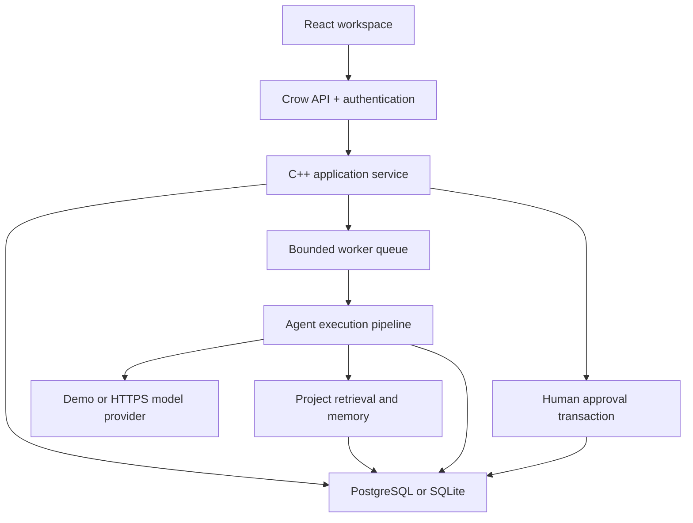

# Architecture

## Boundaries

React communicates with Crow through a same-origin `/api` proxy. C++ owns all business logic and authorization. The `Database` adapter supports SQLite prepared statements or libpq parameterized queries. PostgreSQL is the Compose default; local tests use SQLite. A recursive mutex serializes the shared connection, and `Transaction` holds that lock for the entire atomic operation.

## Agent cooperation

Multi-agent runs execute ordered roles because each stage consumes earlier outputs. Independent runs can execute concurrently on two workers. The queue has a capacity of 32; each user is limited to two active runs. Each agent has its own class and system instructions. A factory supplies instances and a static registry supplies known IDs.

`AgentContext` contains the user goal, validated numeric constraints, retrieved sources, recent project memories and prior agent outputs. `AgentCommunicationManager` persists structured messages to the shared-context recipient. `AgentResultEvaluator` enforces the output object schema and size limits. A failed stage marks the run failed and does not create an approval or tasks.

The Orchestrator role consolidates the prior outputs; coordination itself is performed by `Service::executeRun`. Execution is a restricted application workflow: approval creates tasks in a transaction and records an execution/message. Agents have no shell, email, browser or arbitrary API tool permission.

## Retrieval

Document upload validates filename, extension, encoding and size. TXT/MD are UTF-8 text. DOCX uses libarchive and reads only `word/document.xml`; output and archive-entry counts are bounded. PDF uses `pdftotext` in a child process with CPU, memory, file-output and wall-clock limits. No shell is used. Image-only PDF/OCR and layout reconstruction are not implemented.

Text is split near 1,800 bytes with approximately 200 bytes of overlap while respecting UTF-8 boundaries. Each chunk stores its model identifier and vector. Retrieval computes cosine similarity in C++ over project-filtered chunks and returns up to five positive matches. A dedicated balanced k-d tree indexes normalized vectors in C++; nearest Euclidean neighbours have the same ranking as cosine similarity. Up to eight project/model indexes are cached. Each search checks an ordered database ID manifest and rebuilds when uploads/deletions change it; indexes rebuild from persisted vectors after restart. This is exact, not approximate retrieval. High-dimensional queries may still approach a full scan; no pgvector/HNSW service or throughput claim is implied. Demo vectors hash lexical tokens into 256 buckets and are explicitly labeled non-semantic. Live vectors come from the configured embedding endpoint. Mixed embedding models are never compared.

## Persistence and failure semantics

All proposals, messages, execution records and decisions persist. Approval status and generated tasks commit together; repeated review attempts return HTTP 409. Dependency updates reject cycles, foreign-project tasks and completion before prerequisites. Reopening a prerequisite of a completed task is rejected.

On restart, queued/running runs are marked failed rather than silently retried. Completed decisions survive. This is a single-server architecture: multiple backend replicas sharing one database are not supported because startup reconciliation and the in-memory queue are not coordinated across replicas.

## Security model

Passwords use PBKDF2-HMAC-SHA256 with 600,000 iterations and random salts. Session tokens use cryptographic random bytes; only token hashes are stored. Cookies are HttpOnly, SameSite=Strict and optionally Secure. Mutating requests require a custom header, browser origins must equal `APP_ORIGIN`, and no permissive CORS is enabled. SQL values are bound. Project actions resolve workspace membership server-side. The platform admin flag does not override project isolation.

Rate limits are in-memory per remote address, appropriate for a single instance; a shared reverse proxy may cause users to share that limit. The nginx request-body limit supplements application validation. Public deployments require TLS, private database networking, backups, dependency review, abuse controls, production observability and an independent security review. Email verification, MFA, account recovery, malware scanning, distributed queueing and automatic provider retries are outside this release.

## Dynamic specialist routing

In live multi-agent mode, AgentRouter requests a structured specialist selection from the configured model. Only planning, research, knowledge and finance are permitted; duplicates/unknown agents fail the run. Memory, critic and orchestrator are always included. Event/budget constraints force finance, retrieved documents force knowledge, and web excerpts force research. Specialists execute in a dependency-safe order; the routing model cannot authorize execution, bypass review or invoke arbitrary tools. The chosen route and explanation appear in the final proposal. Disabled selected agents fail explicitly. Routing adds a model call; its errors are persisted on the run. Demo routing is deterministic and labeled as such; the standard event demonstration still uses all seven generation stages.
