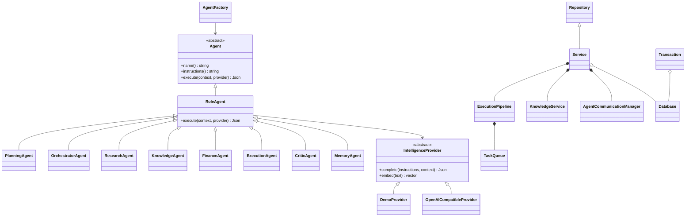
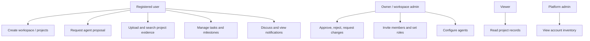

# UML and workflow diagrams

## Class diagram



## Use cases



## Proposal and approval sequence

```mermaid
sequenceDiagram
  participant H as Human
  participant A as C++ API
  participant Q as Worker pipeline
  participant M as Agent team
  participant D as Database
  H->>A: Submit goal and constraints
  A->>D: Verify membership; save run
  A->>Q: Queue bounded execution
  A-->>H: Run ID
  Q->>D: Retrieve project sources and memory
  loop Ordered specialized roles
    Q->>M: Goal + constraints + preceding outputs
    M-->>Q: Validated structured result
    Q->>D: Persist execution and shared message
  end
  Q->>D: Save proposal + pending approval
  H->>A: Poll status and inspect proposal
  A-->>H: Results, sources, errors and status
  H->>A: Approve
  A->>D: Transaction: verify pending + role
  A->>D: Insert tasks and approval decision
  A->>D: Commit
  A-->>H: Created task IDs
```

## Document ingestion sequence

```mermaid
sequenceDiagram
  participant H as Human
  participant A as C++ API
  participant K as Knowledge service
  participant P as Embedding strategy
  participant D as Database
  H->>A: Upload filename + base64 bytes
  A->>D: Authorize project membership
  A->>K: Validated upload
  K->>K: Extract UTF-8 text; chunk with overlap
  loop Each bounded chunk
    K->>P: Generate vector
    P-->>K: Vector + model identity
  end
  K->>D: Atomic document + chunk insertion
  A-->>H: Document ID and index details
```
